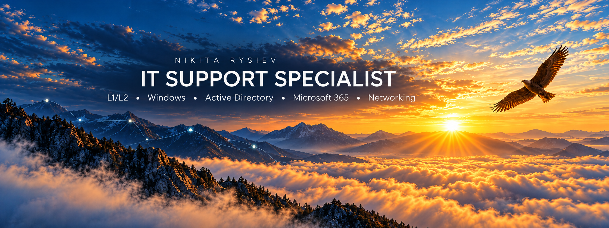

# Hi there, I'm Nikita 🙂

### 👨‍💻 IT Support Specialist (L1/L2) | Systems Administrator

I am an experienced IT professional with a solid 3-year background in Technical Support (L1/L2) and IT infrastructure maintenance. I specialize in root cause analysis (RCA), hardware/software troubleshooting, and managing corporate environments (Active Directory, Microsoft 365, Windows Server). I combine strong analytical skills with hands-on technical expertise to resolve complex incidents efficiently and maintain high SLA standards.

### 🛠️ Tech Stack & Tools
- **Systems & Admin:** Windows (10/11), Windows Server (2016-2022), Active Directory, Entra ID (Azure AD), Microsoft 365
- **Networking & Hardware:** LAN/WLAN, TCP/IP, DNS, DHCP, VPN, PC/Laptop Diagnostics, Network Printers
- **Tools & Processes:** Jira, ServiceNow, SLA Management, SCCM / Intune
- **Scripting & Web:** PowerShell, Bash, Git, HTML/CSS, API basics (Postman)

### 🚀 Currently working on
- Automating daily administrative tasks and IT support workflows using **PowerShell**.
- Expanding my expertise in cloud identity management (**Entra ID**) and endpoint deployment (**Intune**).
- Delivering fast, reliable, and user-centric technical support for enterprise environments.

### 📫 How to reach me
- **LinkedIn:** [in/nikita-rysiev](https://www.linkedin.com/in/nikita-rysiev-a4b7921b4/)
- **Portfolio:** [nikita-portfolio.com.pl](http://www.nikita-portfolio.com.pl)
- **Email:** nikita.rysiev@gmail.com
